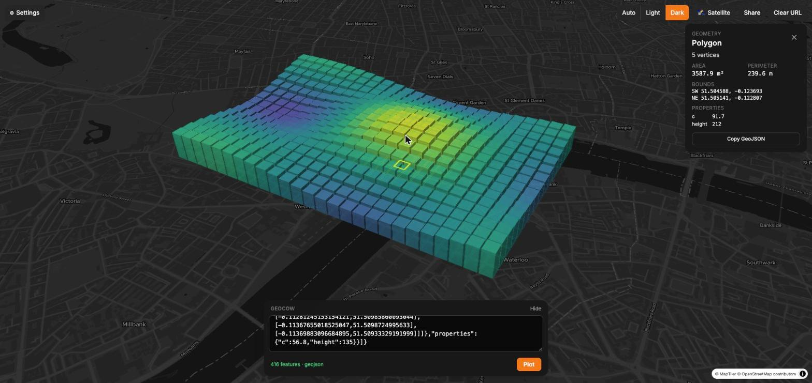

<div align="center">

# geocow 🐄

**High-precision ETRS89 ↔ British National Grid — from the command line, an HTTP API, or a map.**

[](https://github.com/tbbuck/geocow/actions/workflows/ci.yml)
[](LICENSE)
[](https://www.rust-lang.org)

### [Try it at geocow.uk →](https://geocow.uk)



</div>

---

Paste WKT or GeoJSON and see it on a map. Pipe it through the CLI and get
National Grid eastings and northings back. POST it from `psql` and get a link.
Whichever way in, the coordinates go through Ordnance Survey's **OSTN15** grid —
and geocow refuses to start if it can't prove that grid is loaded and correct.

```console
$ echo 'POINT(-1.5 52.4)' | geocow transform --to 27700
POINT(434115.77580714034 278114.07152933464)

$ psql -Atc "select st_astext(geom) from parcels where id = 42" | geocow map
# → opens the parcel on a map, fitted to it
```

## Why geocow

Converting between ETRS89 (GPS-ish lon/lat) and OSGB36 (the British National
Grid) with a 7-parameter Helmert transformation is good to a few metres.
Ordnance Survey's OSTN15 grid gets you to within a centimetre — but only if the grid
file is actually present, actually readable, and actually applied in the right
direction. Most tools shrug and fall back to Helmert without telling you.

geocow doesn't. Before *any* subcommand runs — CLI, server or container — it
transforms OS reference point **TP01** and checks the result against the
published easting/northing to within **1 mm**. No grid, wrong grid, or a grid
PROJ can't read: it exits `2` with instructions, and nothing else happens.

CI then checks all **40 OS reference points** (TP01–TP40, Scilly to Shetland
and the Isle of Man) in both directions. See [Accuracy](#accuracy).

## What's in the box

| | |
|---|---|
| **`geocow transform`** | Reproject WKT or GeoJSON on stdin between EPSG:4258 and EPSG:27700 |
| **`geocow serve`** | The web map and HTTP API — one binary, one container |
| **`geocow map`** | `pbpaste \| geocow map` — open whatever's on your clipboard on a map |

---

## Quickstart

The grid geocow uses is committed to the repo, so a clone is all you need.

### Docker

```sh
git clone https://github.com/tbbuck/geocow && cd geocow
docker compose up -d --build
open http://127.0.0.1:8787
```

### From source

You'll need Rust 1.85+, PROJ **≥ 9.4** with headers and pkg-config, and — for
the web map — Node 22 with Yarn 4 via corepack.

```sh
brew install proj pkg-config                # macOS
sudo apt install libproj-dev pkg-config     # Debian/Ubuntu (24.04+ for PROJ 9.4)

git clone https://github.com/tbbuck/geocow && cd geocow
cargo install --path .                      # installs `geocow`
export GEOCOW_GRID_DIR="$PWD/OSTN15_NTv2"   # so it finds the grid from anywhere

echo 'POINT(-1.5 52.4)' | geocow transform --to 27700

yarn --cwd web install && yarn --cwd web build
geocow serve                                # http://127.0.0.1:8787
```

`cargo install --path . --no-default-features` gives a lean, transform-only
binary with no async runtime.

---

## The CLI

### `geocow transform`

```sh
geocow transform --from 4258 --to 27700   # ETRS89 → National Grid
geocow transform --from 27700 --to 4258   # and back
```

Reads stdin, writes stdout. Detects WKT vs GeoJSON from the first meaningful
character and answers in the same format:

```console
$ echo '{"type":"Point","coordinates":[-1.5,52.4]}' | geocow transform --to 27700
{"type":"Point","coordinates":[434115.77580714034,278114.07152933464]}

$ geocow transform --from 27700 < boundary.wkt > boundary_etrs89.wkt
```

- Covers Point, LineString, Polygon, MultiPoint, MultiLineString, MultiPolygon
  and GeometryCollection.
- `4258 ↔ 27700` is the only pair that transforms — that's the point of the
  tool. Anything else is a descriptive error, never a quiet approximation, and
  EPSG:4326 gets an explanation of why it isn't ETRS89.
- Both flags default to `4258`, so pass at least `--to` to actually reproject.
- Exit codes: `0` success, `1` bad input, `2` grid missing or invalid.

### `geocow map`

```sh
pbpaste | geocow map                  # open the clipboard on geocow.uk
geocow map boundary.geojson           # or a file
geocow map --print < site.wkt         # just print the URL
geocow map --url http://127.0.0.1:8787 --browser "Firefox" < site.wkt
```

The geometry is validated *before* a browser opens, then packed into the URL
fragment (gzip + base64url) — byte-compatible with the web app's own Share
button; a test pins a browser-made payload to prove the Rust and JS codecs
agree. National Grid coordinates are detected and reprojected when the page
loads. `GEOCOW_URL` and `GEOCOW_BROWSER` set the defaults.

---

## The web map

MapLibre GL + Lit + Tailwind, served by `geocow serve`.

- **Paste anything** — WKT, a bare GeoJSON geometry, a Feature or a
  FeatureCollection. The box has focus on load; `/` jumps back to it,
  <kbd>⌘/Ctrl</kbd>+<kbd>Enter</kbd> plots.
- **Paste it badly and it still works.** Geometry copied out of a terminal or a
  CLI table arrives wrapped across lines, fenced in `|` rules or box-drawing
  borders, with an EWKT `SRID=…;` prefix, smart quotes or a trailing semicolon.
  All of it is stripped and the fragments rejoined before parsing, and the
  status line says what it did.
- **Including numbers the wrap cut in half.** A terminal breaking at the
  window edge can put a newline *inside* `525217.1988`. Two things give it
  away, and neither is a guess: coordinates share a shape (a stray `88` is
  plainly half of something), and WKT declares its dimensionality, so a group
  of three ordinates where the geometry says two *proves* a split. Tested at
  every wrap width from 16 to 200 columns.
- **Drop files anywhere** — GeoJSON, newline-delimited GeoJSON, or
  WKT-per-line. The format is sniffed from content, never the filename,
  because a `.geojson` full of NDJSON is a Tuesday. GeoJSON and NDJSON are
  parsed in the browser, so a 22 MB drop never touches the network.
- **National Grid is detected.** Coordinates outside lon/lat bounds are taken
  as EPSG:27700 and reprojected through OSTN15 on the way in.
- **Style by your data** — extrude polygons by a numeric property, colour
  through viridis, magma, inferno, plasma or cividis. Both switch on by
  themselves when the property is present.
- **Click a feature** to focus it: the rest fades back, and a panel shows its
  type, vertex count, bounding box, approximate area/length and properties.
- **Light, dark and satellite**, following `prefers-color-scheme` unless you
  choose. Optional hi-res aerial imagery can be layered on top
  ([configuration](#configuration)).
- **Share links.** The viewport lives in the URL hash and Share packs the
  geometry in beside it. Past a URL-length threshold it falls back to a short
  link backed by a small in-memory store (last 10 payloads, gone on restart —
  deliberately ephemeral).
- **The URL is live.** Paste another geocow link over the current one and the
  map follows; back and forward step through plots and shares. Camera moves
  are animated, but the address bar always shows where the map is *going*, so
  holding the back button through several entries never leaves them
  disagreeing (see [`navigation.ts`](web/src/navigation.ts)).

---

## HTTP API

| Method | Path | Body | Purpose |
|---|---|---|---|
| `GET` | `/api/health` | — | `ok` |
| `GET` | `/api/config` | — | Map settings for the frontend (tile key, aerial overlay) |
| `POST` | `/api/parse` | `{"input": "…"}` | Parse to a normalised FeatureCollection |
| `POST` | `/api/transform` | `{"input": "…", "from": 27700, "to": 4258}` | Reproject; returns GeoJSON *and* the input re-serialised in its own format |
| `POST` | `/api/parse-file` | raw text | As `/api/parse`, for GeoJSON, NDJSON or WKT-per-line bodies |
| `POST` | `/api/transform-file?from=&to=` | raw text | As `/api/transform`, raw body |
| `POST` | `/api/share` | raw bytes | Stash a payload (≤ 10 MiB), get an id back |
| `GET` | `/api/share/{id}` | — | Retrieve it, or `404` once evicted |
| `POST` | `/api/geometry` | raw text or WKB | **Authenticated.** Store geometry and return a URL that shows it |

Geometry bodies may be up to 256 MiB. Note that the `/api/transform*` routes
default to `27700 → 4258` (what the map wants), unlike the CLI. Bad input is a
`422` with `{"error": "…"}` — a bad line in a large upload is reported with its
line number and a snippet; anything else is a `500`.

```sh
curl -s localhost:8787/api/transform \
  -H 'content-type: application/json' \
  -d '{"input":"POINT(434115.78 278114.07)","from":27700,"to":4258}'
```

### Pushing geometry from your shell

`POST /api/geometry` is the machine-facing counterpart to pasting: send a
query result straight from a terminal and open the link it hands back.

```console
$ curl -sS http://127.0.0.1:8787/api/geometry \
    -H "x-api-key: $GEOCOW_API_KEY" \
    --data-binary @boundary.wkt
{"url":"http://127.0.0.1:8787/#s=4bd7…","id":"4bd7…","features":1,
 "from":27700,"to":4258,"transformed":true,"source_crs":"detected"}

$ duckdb -noheader -list -c "select st_astext(geom) from plots" |
    curl -sS localhost:8787/api/geometry -H "x-api-key: $GEOCOW_API_KEY" --data-binary @-

$ psql -Atc "select encode(ST_AsEWKB(geom), 'hex') from plots where id = 42" |
    xxd -r -p |
    curl -sS localhost:8787/api/geometry -H "x-api-key: $GEOCOW_API_KEY" --data-binary @-
```

- **The CRS is worked out for you.** EWKB states its SRID, so that's believed
  (`"source_crs": "declared"`). Otherwise National Grid eastings/northings look
  nothing like degrees over the British Isles, so geocow reads which you sent
  from where the coordinates are (`"detected"`). `?from=` overrides both
  (`"requested"`).
- **It won't fudge a CRS it can't do.** EWKB declaring EPSG:4326 is refused
  with an error saying so, rather than plotted as if it were ETRS89. Pass
  `?from=4258` if that's what you meant.
- **Accepts what a file drop accepts, plus binary:** one WKT/GeoJSON document,
  NDJSON, WKT-per-line, or raw **WKB** straight from `ST_AsBinary` — OGC, ISO
  and PostGIS EWKB, either byte order (mixed within one payload, even), several
  geometries back to back. Z and M are read and dropped; geocow is
  horizontal-only. The body is sniffed, so there's no flag or content type to
  get right. Feature properties survive.
- **The link points at the host you posted to.** Set `GEOCOW_PUBLIC_URL` when
  the public origin differs from the `Host` the server sees.
- **Auth** is one shared key, `GEOCOW_API_KEY`, sent as `x-api-key` or
  `Authorization: Bearer`, compared in constant time. With no key configured
  the endpoint is disabled (`503`).
- **Links are ephemeral** — the same bounded store the Share button uses.

---

## Configuration

All environment variables; the `serve` and `map` ones can also be passed as
flags (see `geocow <command> --help`).

| Variable | Default | Used by |
|---|---|---|
| `GEOCOW_GRID_DIR` | `./OSTN15_NTv2`, then `OSTN15_NTv2/` beside the executable | everything |
| `GEOCOW_BIND` | `127.0.0.1:8787` | `serve` |
| `GEOCOW_WEB_DIR` | `web/dist` | `serve` |
| `GEOCOW_MAPTILER_KEY` | unset → keyless [OpenFreeMap](https://openfreemap.org) styles, no satellite | `serve` |
| `GEOCOW_AERIAL_TILE_URL` | unset → no aerial overlay. An XYZ template, e.g. `https://tiles.example.com/{z}/{x}/{y}.jpg` | `serve` |
| `GEOCOW_AERIAL_ATTRIBUTION` | unset | `serve` |
| `GEOCOW_API_KEY` | unset → `POST /api/geometry` disabled | `serve` |
| `GEOCOW_PUBLIC_URL` | unset → derived from `Host` / `X-Forwarded-Proto` | `serve` |
| `GEOCOW_URL` | `https://geocow.uk` | `map` |
| `GEOCOW_BROWSER` | the system default | `map` |
| `RUST_LOG` | `geocow=info,tower_http=debug` (a line per request) | `serve` |

Tile keys are served to the browser at run time from `/api/config`, so neither
the frontend bundle nor the Docker image contains one. A MapTiler key is
visible to every visitor — restrict it to your origin in the MapTiler
dashboard.

## Self-hosting

`docker compose up -d --build` runs the whole thing on `127.0.0.1:8787` with
the grid baked into the image. [`deploy/`](deploy/) has an nginx reverse-proxy
example and notes on configuration and continuous deployment.

---

## Accuracy

geocow builds explicit PROJ pipelines against
`OSTN15_NTv2_OSGBtoETRS.gsb` — applied forward for OSGB36 → ETRS89 and
inverted for ETRS89 → OSGB36 — with no `@` optional-grid prefix, so a missing
grid is an error, never a silent fallback. `PROJ_DATA`/`PROJ_LIB` play no part.

| Check | Tolerance |
|---|---|
| Startup gate: TP01, ETRS89 → OSGB36 | 1 mm |
| Test suite: TP01–TP40, ETRS89 → OSGB36 | 10 mm |
| Test suite: TP01–TP40, OSGB36 → ETRS89 | 1×10⁻⁷ ° |

The 10 mm suite ceiling isn't slack: NTv2 interpolates bilinearly in
geographic space, while OS's definitive implementation interpolates in
projected space, and the two differ by up to ~8 mm. Comfortably inside a
centimetre — and a Helmert fallback would be out by metres, so the suite still
proves the grid is in play.

## Limitations

Honest about what isn't here yet — see the [roadmap](ROADMAP.md):

- **One CRS pair.** EPSG:4258 ↔ EPSG:27700 only. ETRS89 is treated as
  GPS-compatible lon/lat, which it is to within a metre or so over GB, but
  WGS84 input is refused rather than assumed.
- **2D only.** Z and M are dropped; there's no vertical (OSGM15) transform.
- **No curved geometries** (CircularString, CompoundCurve, CurvePolygon).
- **No measurement subcommands yet.** The map's info panel shows spherical
  approximations; precise planar and geodesic area/length are planned.
- **Not yet tuned for bulk.** Transforms are per geometry, building a PROJ
  pipeline each time — fine for interactive use, not yet for millions of rows.

---

## Development

Strict red/green TDD: a failing test first, the minimum code to pass, then
refactor. No code without a covering test. See [CONTRIBUTING.md](CONTRIBUTING.md).

```sh
cargo test                          # library, CLI and HTTP API (incl. all 40 OS points)
cargo clippy --all-targets --all-features -- -D warnings
yarn --cwd web test                 # frontend (vitest)

geocow serve                        # backend on :8787 (cargo run -- serve)
yarn --cwd web dev                  # Vite on :5173, /api proxied to :8787
```

```
src/
  main.rs        CLI: clap, the startup gate, subcommand dispatch
  crs.rs         PROJ pipelines, grid discovery and validation
  io.rs          WKT / GeoJSON / NDJSON parsing and writing, CRS detection
  wkb.rs         WKB / EWKB reader (OGC, ISO, both byte orders)
  geom.rs        geometry type wrapper
  error.rs       GeocowError
  web.rs         axum router, /api/config, `serve`        (feature: serve)
  ingest.rs      POST /api/geometry                       (feature: serve)
  share.rs       bounded in-memory share store            (feature: serve)
  launch.rs      `map`: build the URL, open a browser     (feature: map)
  sharelink.rs   gzip + base64url share-payload codec     (features: serve, map)
tests/           CLI and HTTP integration tests
web/             Vite + Lit + Tailwind + MapLibre frontend
OSTN15_NTv2/     the OS grid and its 40 reference points
deploy/          reverse-proxy example and self-hosting notes
```

## Licence

geocow is [MIT](LICENSE) licensed.

The OSTN15 grid and reference points in [`OSTN15_NTv2/`](OSTN15_NTv2/) are
© Crown copyright, Ordnance Survey, distributed under the BSD 2-Clause licence
— see [`OSTN15_NTv2/LICENCE.md`](OSTN15_NTv2/LICENCE.md).

## Acknowledgements

[Ordnance Survey](https://www.ordnancesurvey.co.uk/) for OSTN15 and its test
data · [PROJ](https://proj.org) · the [georust](https://georust.org) crates ·
[MapLibre GL JS](https://maplibre.org) · [MapTiler](https://www.maptiler.com) ·
[OpenFreeMap](https://openfreemap.org) and [OpenStreetMap](https://www.openstreetmap.org/copyright)
contributors.
